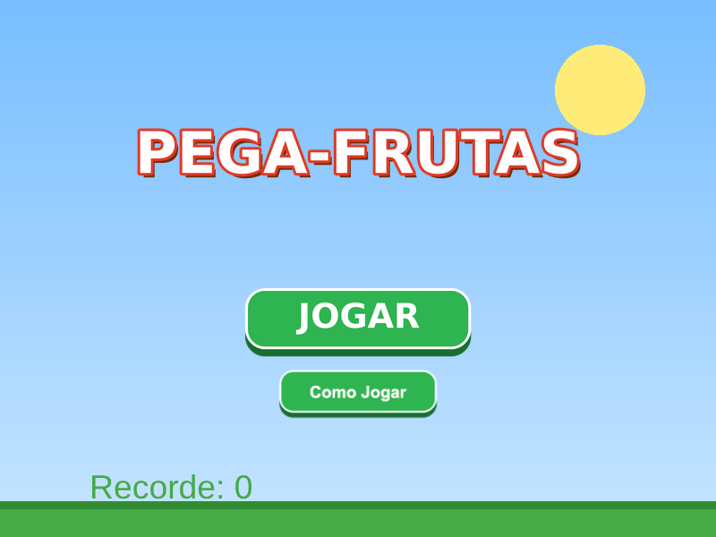
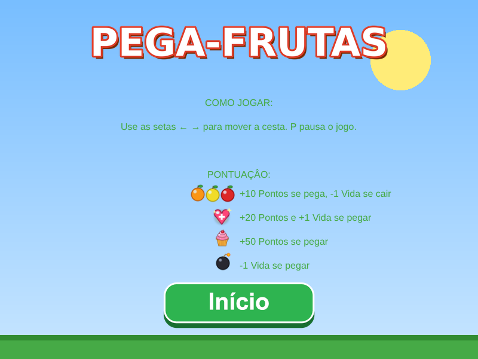
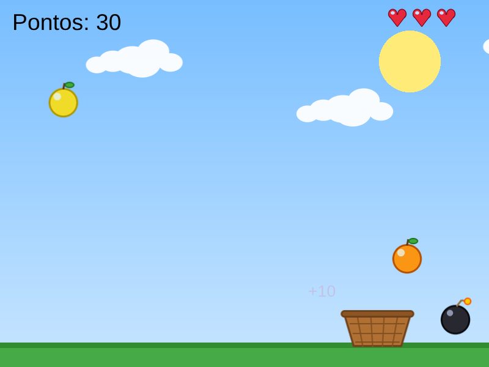
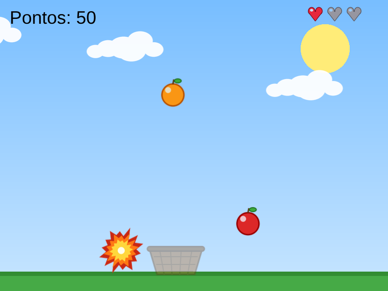
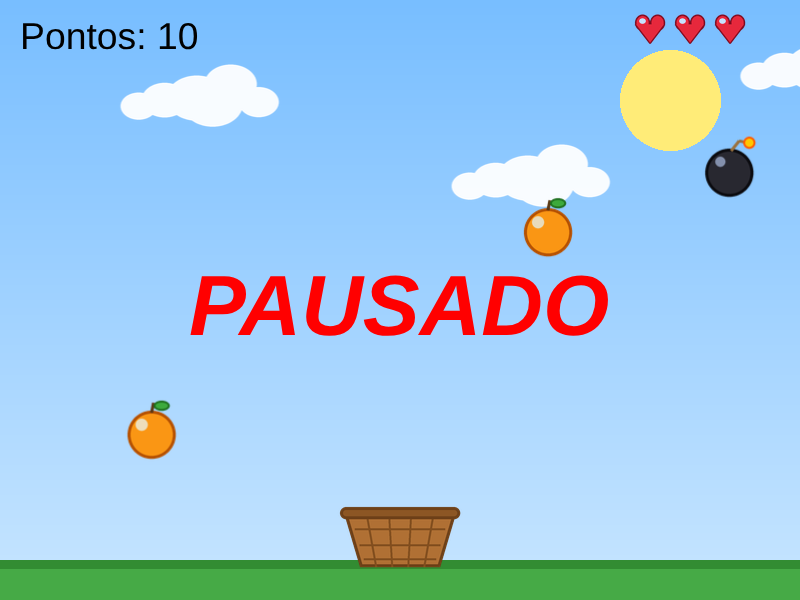
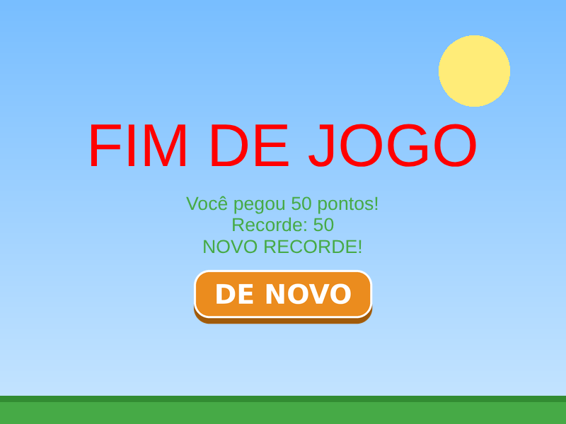

# 🍎 Pega-Frutas

Jogo de arcade em 2D, feito no Construct 3, em que você move uma cesta para pegar as frutas que caem do céu, desviar das bombas e bater o seu recorde.

▶️ **Jogue agora:** [https://lcstinoco.github.io/Pega-frutas/](https://lcstinoco.github.io/Pega-frutas/)

<p align="center">
  
</p>

## Sumário

- [Descrição geral](#descrição-geral)
- [Ferramenta utilizada](#ferramenta-utilizada)
- [Instalação e execução](#instalação-e-execução)
- [Capturas de tela](#capturas-de-tela)
- [Versão jogável](#versão-jogável)
- [Estrutura do repositório](#estrutura-do-repositório)
- [Créditos](#créditos)

## Descrição geral

### Enredo

É dia de colheita no pomar, e as frutas resolveram despencar todas de uma vez. Sobrou para a sua cesta de vime a missão de salvar a safra antes que as frutas toquem o chão. Só que alguém misturou bombas no meio da colheita, e um descuido faz a cesta explodir. Com sorte, corações caem de vez em quando para devolver as suas energias, e cupcakes raros valem muitos pontos.

### Objetivo

Pegue o máximo de frutas possível sem ficar sem vidas. Você começa com **3 vidas**. O jogo termina quando elas acabam, e o seu melhor resultado fica registrado como **recorde**.

### Pontuação

| Item | Efeito |
| --- | --- |
| 🍎🍊🍋 Frutas | **+10 pontos** ao pegar, **-1 vida** se caírem no chão |
| 💖 Coração | **+1 vida** (máximo de 3) e **+20 pontos** |
| 🧁 Cupcake | **+50 pontos** |
| 💣 Bomba | **-1 vida** ao tocar a cesta, com explosão |

### Controles

| Tecla ou ação | O que faz |
| --- | --- |
| ← → | Move a cesta |
| **P** | Pausa e retoma o jogo |
| Clique ou **Enter** | Aperta os botões JOGAR, Início e DE NOVO |

### Recursos do jogo

- Telas de **menu**, **como jogar**, **jogo** e **fim de jogo**.
- **Recorde salvo no navegador** (Local Storage), com aviso de "NOVO RECORDE!".
- Marcador de **vidas em corações** e pontos flutuantes (+10) ao pegar um item.
- **Efeitos sonoros** (coleta, explosão, clique, passar o mouse, vida e derrota) e **música de fundo**.
- **Explosão animada** quando a bomba toca a cesta, e nuvens que se movem pelo céu.

## Ferramenta utilizada

- **[Construct 3](https://www.construct.net/en)**: editor de jogos no navegador, usado com programação visual por **eventos**, sem escrever código.
- **Exportação:** Web (HTML5), o que permite jogar em qualquer navegador moderno.
- **Hospedagem:** GitHub Pages.

## Instalação e execução

Não há instalador nem arquivo `.exe`. O jogo roda no navegador, e há três formas de abri-lo.

### 1. Jogar online (a mais fácil)

Abra o link: **[https://lcstinoco.github.io/Pega-frutas/](https://lcstinoco.github.io/Pega-frutas/)**

### 2. Rodar no seu computador

O jogo exportado precisa de um servidor web, então **dar dois cliques em `index.html` não funciona**. Faça assim:

1. Baixe o projeto: botão verde **Code** > **Download ZIP** (ou rode `git clone https://github.com/lcstinoco/Pega-frutas.git`).
2. Descompacte o arquivo.
3. Abra o terminal dentro da pasta `docs`.
4. Inicie um servidor local (requer [Python](https://www.python.org/downloads/)):

   ```bash
   python -m http.server 8000
   ```

   No Windows, se `python` não funcionar, use `py -m http.server 8000`.
5. Abra `http://localhost:8000` no navegador.

Se você usa o Visual Studio Code, também funciona abrir a pasta `docs` com a extensão **Live Server**.

### 3. Abrir e editar no Construct 3

1. Baixe o projeto como no passo anterior.
2. Acesse o [editor do Construct 3](https://editor.construct.net) em um navegador **Chrome ou Edge**.
3. No menu (☰), escolha **Open** > **Open project folder** e selecione a pasta `projeto`.
4. Clique em **Preview** (▶) para testar o jogo.

> A edição gratuita do Construct 3 limita o número de eventos de um projeto. O Pega-Frutas foi feito dentro desse limite.

## Capturas de tela

| Menu | Como jogar |
| :---: | :---: |
|  |  |

| Partida | Explosão da bomba |
| :---: | :---: |
|  |  |

| Pausa | Fim de jogo |
| :---: | :---: |
|  |  |

## Versão jogável

🎮 **Link jogável:** [https://lcstinoco.github.io/Pega-frutas/](https://lcstinoco.github.io/Pega-frutas/)

O jogo funciona em computador, com o teclado. A versão publicada usa o GitHub Pages e abre direto no navegador, sem instalação.

## Estrutura do repositório

```
Pega-fruta/
├── assets/     Pacote com os sprites e sons usados no jogo (sprites e sons.zip)
├── docs/       Versão exportada (HTML5), publicada pelo GitHub Pages
├── imagens/    Capturas de tela usados neste README
├── projeto/    Projeto do Construct 3 (layouts, folhas de eventos e objetos)
└── README.md
```

## Créditos

- **Autores: Ian Pablo, Lucas Tinoco, Samuel Marcelino, Pedro Vittor**
- Jogo desenvolvido com o [Construct 3](https://www.construct.net/en).
- Sprites e efeitos sonoros criados especialmente para este projeto.
